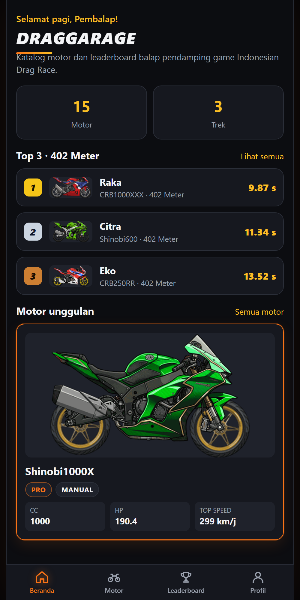
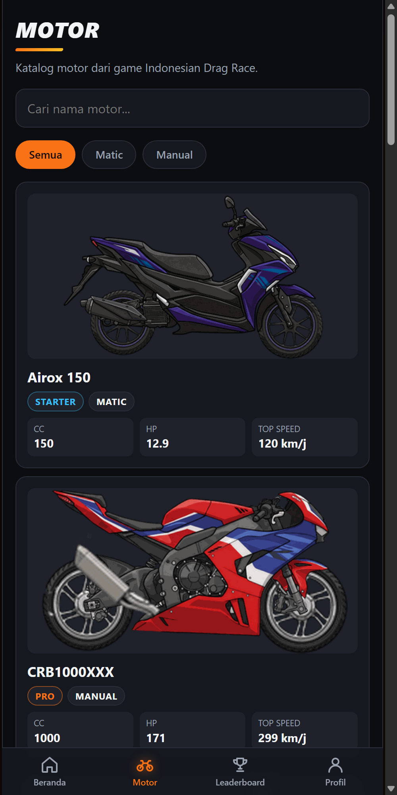
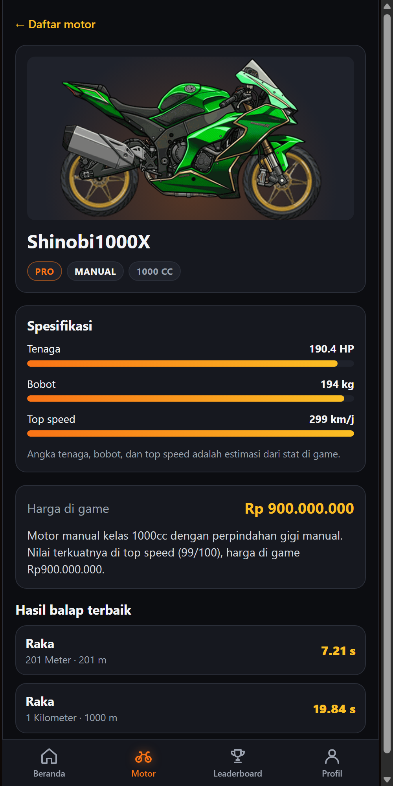
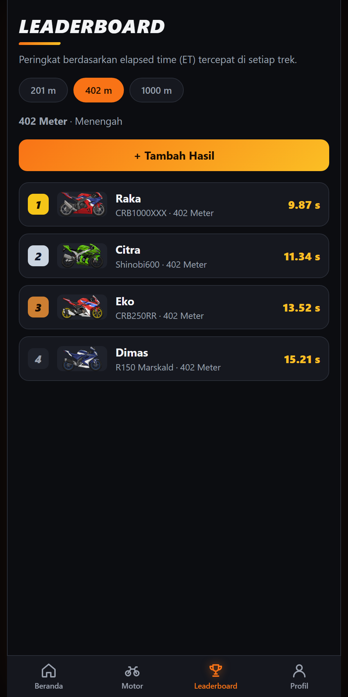
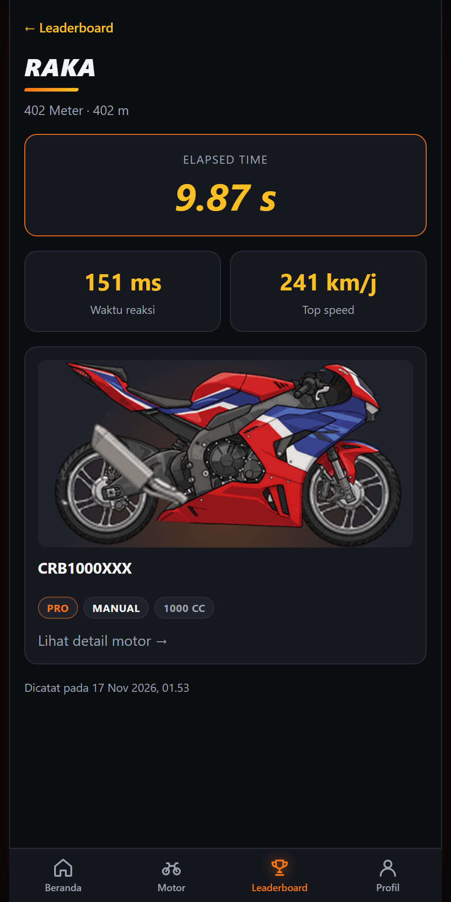
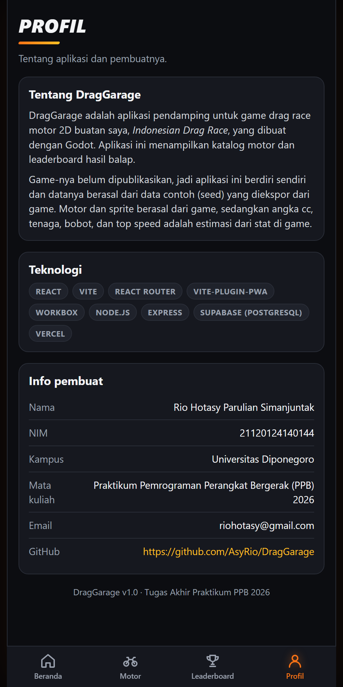

# DragGarage: Katalog Motor Drag & Leaderboard Balap

Aplikasi pendamping untuk game drag race motor 2D **Indonesian Drag Race** (dibuat dengan Godot). DragGarage menampilkan katalog motor beserta spesifikasinya dan leaderboard hasil balap per trek. Aplikasi berbentuk **PWA** sehingga bisa di-install di HP dan tetap terbuka saat offline.

> **Catatan:** game Indonesian Drag Race belum dipublikasikan, jadi aplikasi ini berdiri sendiri dan seluruh datanya berasal dari **data contoh (seed)** yang diekspor dari game. Daftar motor, nama, transmisi, harga, dan sprite berasal dari game. Nilai cc, tenaga (HP), bobot, dan top speed adalah **estimasi** yang diturunkan dari stat 0-100 di game (bukan angka resmi), sedangkan hasil balap di leaderboard adalah data contoh.

Tugas Akhir Praktikum Pemrograman Perangkat Bergerak (PPB) 2026, dikerjakan secara individu.

## Demo dan Screenshot

| | Tautan |
|---|---|
| Aplikasi (web/PWA) | https://drag-garage-web-three.vercel.app |
| API | https://drag-garage-api.vercel.app (contoh: [`/api/motors`](https://drag-garage-api.vercel.app/api/motors)) |

| Beranda | Daftar Motor | Detail Motor |
|---|---|---|
|  |  |  |

| Leaderboard | Detail Hasil | Profil |
|---|---|---|
|  |  |  |

## Fitur

- **Katalog motor:** pencarian nama, filter transmisi (matic/manual), dan detail lengkap dengan bar spesifikasi (tenaga, bobot, top speed), harga di game, serta deskripsi.
- **Leaderboard:** peringkat berdasarkan elapsed time (ET) tercepat, difilter per trek (201 m, 402 m, 1000 m).
- **Tambah motor:** form di halaman Motor untuk menambah motor ke katalog. Jika kolom gambar dikosongkan, aplikasi mencari `/motors/<nama-motor>.png`.
- **Tambah hasil balap:** form sederhana yang mengirim data ke API.
- **Sprite motor** dengan rasio tetap 2:1, lazy loading, dan fallback otomatis ke siluet generik jika gambar tidak ada.
- **PWA:** bisa di-install, service worker dengan precache aset, cache API (NetworkFirst), dan banner saat offline.
- **Intro animasi:** saat aplikasi dibuka, muncul judul DragGarage, motor wheelie lalu melaju keluar layar, kemudian masuk ke beranda. Hanya tampil sekali per sesi, bisa dilewati, dan otomatis dilewati jika perangkat memakai pengaturan "kurangi animasi".
- **Mobile-first:** konten maksimal 480 px di tengah layar saat dibuka di desktop, tema gelap bernuansa balap.

### Halaman (6 halaman)

| # | Halaman | Rute | Keterangan |
|---|---|---|---|
| 1 | Beranda | `/` | Sapaan, jumlah motor dan trek, top 3 leaderboard, motor unggulan |
| 2 | Daftar Motor (list) | `/motors` | Pencarian, filter, form tambah motor; setiap kartu bisa diklik |
| 3 | Detail Motor | `/motors/:id` | Spesifikasi, harga, deskripsi, hasil balap terbaik |
| 4 | Leaderboard (list) | `/leaderboard` | Filter per trek, form tambah hasil; setiap baris bisa diklik |
| 5 | Detail Hasil | `/results/:id` | Pemain, motor, trek, waktu reaksi, ET, top speed |
| 6 | Profil / About | `/profile` | Tentang aplikasi, teknologi, info pembuat |

Navigasi utama berupa **Bottom Navigation** dengan 4 menu (Beranda, Motor, Leaderboard, Profil). Halaman detail dibuka dengan mengklik item pada halaman list.

## Tech Stack

| Bagian | Teknologi |
|---|---|
| Frontend | React, Vite, React Router, JavaScript |
| PWA | vite-plugin-pwa (Workbox) |
| Backend | Node.js, Express, CORS, dotenv |
| Database | Supabase (PostgreSQL) lewat `@supabase/supabase-js` |
| Hosting | Vercel (web dan API sebagai dua project terpisah) |

## Struktur Folder

```
DragGarage/
├── api/                      # Web service (Express + Supabase)
│   ├── db/
│   │   ├── schema.sql        # Skema tabel (jalankan dulu di Supabase)
│   │   └── seed.sql          # Data contoh
│   ├── src/
│   │   ├── config/           # Koneksi Supabase
│   │   ├── models/           # Query ke database
│   │   ├── controllers/      # Validasi input dan logika respons
│   │   ├── routes/           # Definisi endpoint (index.js = agregator)
│   │   ├── utils/            # Format respons, validasi, error handler
│   │   └── index.js          # Entry point (export app untuk Vercel)
│   ├── .env.example
│   ├── vercel.json
│   └── package.json
├── web/                      # Frontend PWA (React + Vite)
│   ├── public/
│   │   ├── motors/           # Sprite motor dari game (PNG) + motor-fallback.svg
│   │   └── icons/            # Ikon PWA
│   ├── scripts/              # Skrip pembuat ikon PWA dan sprite cadangan
│   ├── src/
│   │   ├── components/       # BottomNav, MotorImage, MotorCard, dll.
│   │   ├── pages/            # Halaman aplikasi
│   │   ├── services/api.js   # Semua panggilan ke API
│   │   ├── hooks/            # useFetch, useDebounce
│   │   ├── config/profile.js # Nama dan NIM pembuat
│   │   └── utils/
│   ├── .env.example
│   ├── vercel.json           # Rewrite SPA
│   └── vite.config.js        # Konfigurasi PWA
└── README.md
```

## Menjalankan Secara Lokal

Prasyarat: Node.js 20 atau lebih baru dan akun Supabase (gratis).

### 1. Database (Supabase)

1. Buat project baru di [supabase.com](https://supabase.com).
2. Buka **SQL Editor**, jalankan isi `api/db/schema.sql`, lalu `api/db/seed.sql`.
3. Buka **Project Settings → API Keys**, lalu salin **Project URL** dan **Secret key** (`sb_secret_...`).

> Skema mengaktifkan Row Level Security tanpa policy. Hanya API (yang memakai secret key) yang bisa mengakses data. Jangan pernah memakai secret key di frontend.

### 2. API

```bash
cd api
npm install
cp .env.example .env     # lalu isi SUPABASE_URL dan SUPABASE_KEY
npm run dev              # http://localhost:3000
```

`SUPABASE_URL` berbentuk `https://<project-ref>.supabase.co` (tanpa garis miring di akhir dan tanpa `/rest/v1`). Tes dengan membuka `http://localhost:3000/api/motors`.

### 3. Web

```bash
cd web
npm install
cp .env.example .env     # opsional untuk lokal; isi VITE_API_URL jika API tidak di localhost:3000
npm run dev              # http://localhost:5173
```

Build produksi dan uji PWA:

```bash
npm run build
npm run preview          # http://localhost:4173
```

## Dokumentasi API

Semua respons berformat `{ "success": true/false, "message": "...", "data": ... }`. Kode status yang dipakai: `200`, `201`, `400` (validasi gagal / ID tidak valid), `404` (data tidak ditemukan), `500` (kesalahan server).

| Method | Endpoint | Keterangan |
|---|---|---|
| GET | `/` | Health check |
| GET | `/api/motors` | Daftar motor. Query: `?search=` (nama), `?transmission=matic\|manual` |
| GET | `/api/motors/:id` | Detail motor |
| POST | `/api/motors` | Tambah motor |
| PUT | `/api/motors/:id` | Ubah motor (boleh sebagian field) |
| DELETE | `/api/motors/:id` | Hapus motor |
| GET | `/api/tracks` | Daftar trek (urut jarak) |
| GET | `/api/tracks/:id` | Detail trek |
| POST | `/api/tracks` | Tambah trek |
| PUT | `/api/tracks/:id` | Ubah trek |
| DELETE | `/api/tracks/:id` | Hapus trek |
| GET | `/api/results` | Daftar hasil balap, urut ET tercepat, sudah join data motor dan trek. Query: `?track_id=`, `?motor_id=` |
| GET | `/api/results/:id` | Detail hasil dengan objek `motor` dan `track` lengkap |
| POST | `/api/results` | Tambah hasil balap |
| DELETE | `/api/results/:id` | Hapus hasil balap |

Contoh body `POST /api/results`:

```json
{
  "player_name": "Raka",
  "motor_id": "<uuid motor>",
  "track_id": "<uuid trek>",
  "reaction_time_ms": 150,
  "elapsed_time_s": 13.14,
  "top_speed_kmh": 158
}
```

## Deploy ke Vercel

Deploy sebagai **dua project** dari repo yang sama:

| Project | Root Directory | Environment Variables |
|---|---|---|
| API | `api` | `SUPABASE_URL`, `SUPABASE_KEY` |
| Web | `web` | `VITE_API_URL` = URL API di Vercel (tanpa garis miring di akhir) |

Deploy API terlebih dulu agar URL-nya bisa dipakai di `VITE_API_URL`. Setelah mengubah environment variable, deploy ulang project terkait.

## Mengganti Sprite Motor

Letakkan gambar di `web/public/motors/` dengan nama file sama seperti kolom `image_url` di tabel `motors` (contoh `/motors/r150.png`). Jika formatnya berbeda (PNG/WebP), perbarui `image_url` di Supabase. Jika gambar tidak ditemukan, aplikasi otomatis memakai `motor-fallback.svg`.

## Pembuat

Nama dan NIM ditampilkan di halaman Profil dan dibaca dari `web/src/config/profile.js`.
